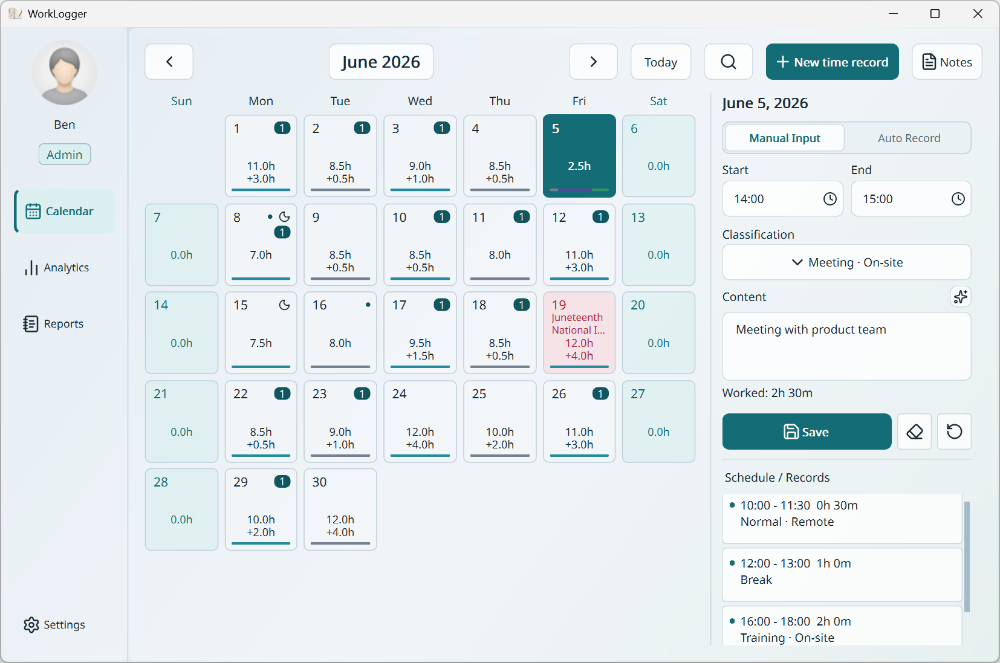

# WorkLogger

WorkLogger is a local desktop application for recording working hours, keeping
daily notes, preparing reports, and reviewing work patterns.



## Getting Started

Start the application and create an account. The first registered account is an
administrator. Store the recovery key privately before continuing.

Use Calendar to record time, Notes for date-specific memos, Reports to prepare
summaries, and Analytics to review totals. Settings manages account preferences,
appearance, data exchange, and optional services.

See the [user guide](docs/user-guide.md) and [documentation index](docs/README.md).

## Run From Source

Use Python 3.11 and a virtual environment. From the repository root on Windows:

```powershell
python -m venv .venv
.\.venv\Scripts\python.exe -m pip install -r requirements.txt
.\.venv\Scripts\python.exe scripts/i18n/i18n_compile.py
.\.venv\Scripts\python.exe -m worklogger.main
```

On macOS or Linux:

```sh
python3 -m venv .venv
.venv/bin/python -m pip install -r requirements.txt
.venv/bin/python scripts/i18n/i18n_compile.py
.venv/bin/python -m worklogger.main
```

Local AI uses the separate optional dependencies in `requirements-ai.txt`.
See [local model setup](docs/local-models.md). Contributors should also read
[development](docs/development.md) and [contributing](CONTRIBUTING.md).

## Data Safety

Use **Settings > Data > Data location** to find the active database. Source runs
and packaged applications use different locations. Back up through Settings
before moving data or replacing an installation.

The database, backups, and exported documents are not encrypted. Protect them
with operating-system permissions and disk encryption. Model files and
operating-system credentials must be transferred separately.
See [configuration](docs/configuration.md) and [security](docs/security.md).

## License

WorkLogger is distributed under the [repository license](LICENSE). Fonts, icons,
and model files have their own licenses. Model weights are not bundled.
